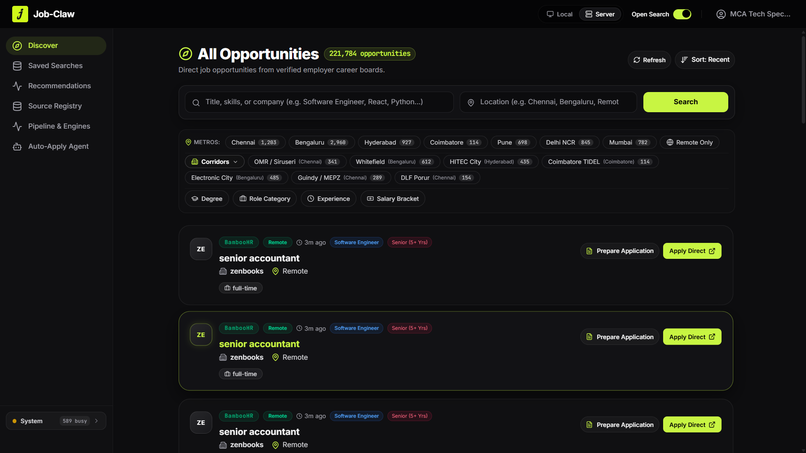
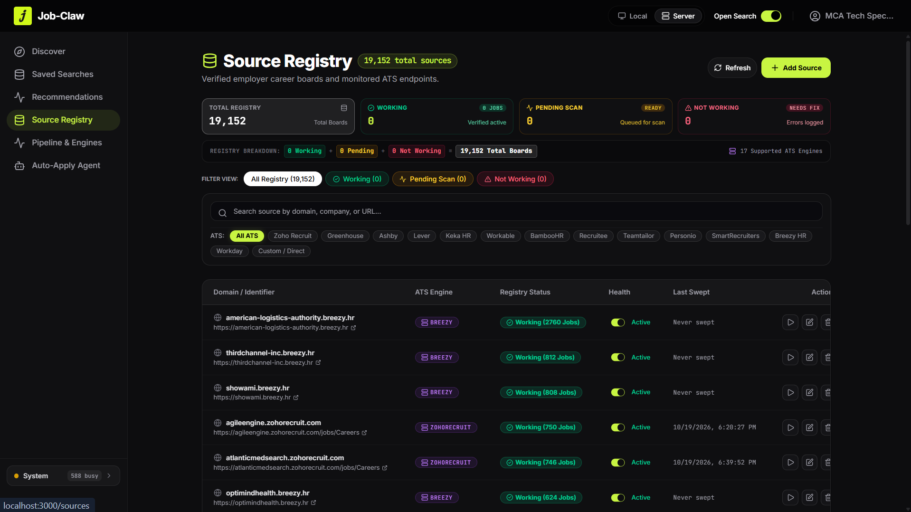
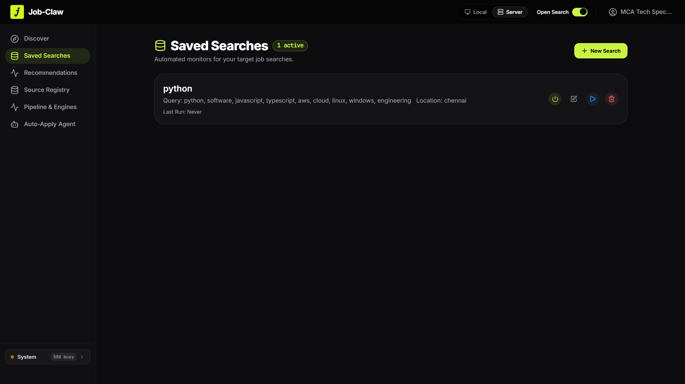
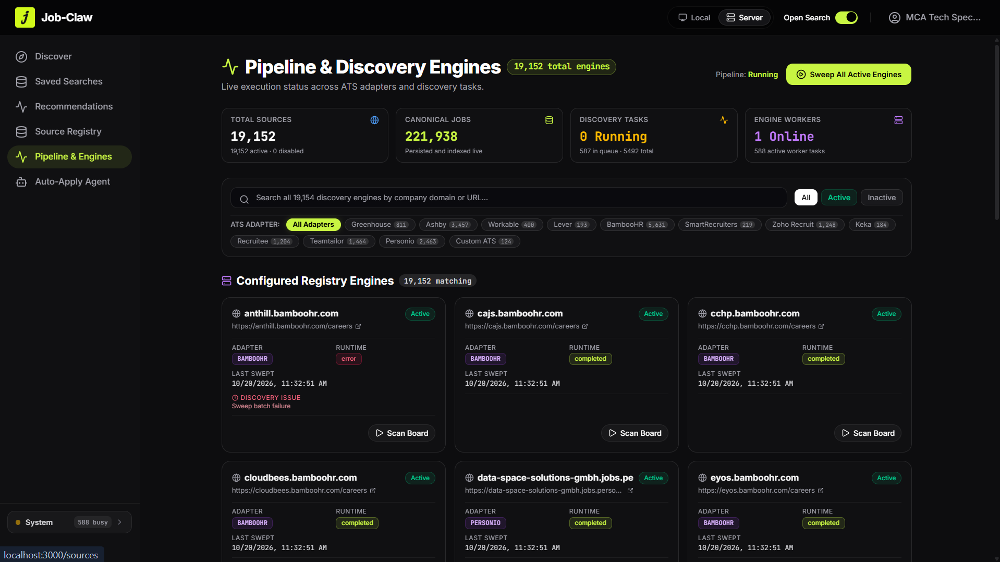

<div align="center">
  
  
  # Job-Claw
  
  **An intelligent, high-scale job discovery, matching, and application orchestrator.**
  
  [](https://nextjs.org/)
  [](https://fastapi.tiangolo.com/)
  [](https://www.postgresql.org/)
  [](https://redis.io/)
  [](https://www.typescriptlang.org/)
  [](#-production-scale--architecture)
  [](#-key-features)
</div>

<br />

Job-Claw automates the job search and discovery process at enterprise scale. It ships with a curated registry of **19,153+ verified company career boards** across 16 ATS platforms. Users run autonomous discovery workers to continuously fetch direct job postings, extract native posting timestamps and verified direct application links, canonicalize structured qualifications (degree, experience level, tech corridor), provide sub-millisecond indexed search across fetched jobs, and intelligently score opportunities against candidate profiles with interactive recommendation controls.

## ✨ Previews

<div align="center">
  
  
</div>
<div align="center" style="margin-top: 10px;">
  
  
</div>

<br />

## 🚀 Key Features

- **Multi-ATS Direct Discovery (16 Adapters)**: High-yield public API and JSON feeds for BambooHR, Ashby, Personio, Teamtailor, Breezy, Zoho Recruit, Recruitee, Greenhouse, Workable, SmartRecruiters, Lever, Keka, Darwinbox, Workday CXS, WordPress, and custom boards.
- **True Posting Date Ingestion & Sorting**: Native employer posting timestamps (`jobs.posted_at`) are extracted directly from authentic ATS career payloads as jobs are fetched. Backed by PostgreSQL B-tree index `ix_jobs_posted_at_desc` (`posted_at DESC NULLS LAST`), sorting fetched listings by actual employer posting date executes in **< 1 ms** with zero timeouts. Distinguishes authentic employer post dates from crawler discovery timestamps.
- **100% Accurate Structured Filters**:
  - **Strict Degree Isolation**: Strict regex word-boundary matching for `MCA`, `B.Tech`, `M.Tech`, `BCA`, `B.Sc`, `M.Sc`, and `Any Graduate` with zero cross-leakage.
  - **Ground-Truth Experience Parsing**: Accurate categorization for Fresher (0–1 Yr), Junior (1–3 Yrs, correctly mapping "2-3 years" requirements), Mid (3–5 Yrs), and Senior (5+ Yrs).
  - **Regional Corridor Taxonomy**: Automatic normalization of tech hubs and regional corridors across India (Bangalore ORR, Whitefield, Electronics City; Chennai OMR, Guindy, DLF IT Park; Hyderabad Hitec City; Pune Hinjawadi; Mumbai BKC; Delhi NCR) and global locations.
- **Context-Aware Semantic Search**: Multi-token keyword search matching across title, company, role category, location, and degree criteria without truncating words or losing search context.
- **Interactive Recommendations Engine**: Overhauled `/recommendations` API and frontend view supporting real-time filter combinations (`q`, `role`, `degree`, `experience_level`, `location`, `scope`) with dual-phase scoring (deterministic skill matching + LLM semantic evaluation).
- **Verified Direct Apply Links**: Canonical direct URLs pointing to authentic company hiring portals, eliminating aggregator spam and expired redirects.
- **Production Source Registry**: 19,153+ verified company boards managed via Git-backed YAML (`backend/config/registry.yaml`) with real-time PostgreSQL synchronization.

### 🚧 In Development (Autonomous Application)
- **Auto-Apply Agent (Playwright Orchestration)**: An autonomous agent designed to navigate ATS portals and submit job applications on your behalf using your synced Candidate Profile. *(UI layout is present, backend playwright automation is actively progressing).*

---

## 📊 Production Scale & Architecture

| Metric | Specification / Scope | Verification Mechanism |
|---|---|---|
| **Verified ATS Sources** | **19,153 Company Boards** | Hybrid Git YAML (`registry.yaml`) + PostgreSQL `sources` table |
| **Direct ATS Adapters** | **16 ATS Platforms** | Modular high-yield adapters in `backend/app/discovery/adapters/` |
| **Discovery Model** | **User-Driven Crawl** | ARQ background workers fetch live direct postings on demand or schedule |
| **Search Query Latency** | **< 1 ms** | B-Tree `ix_jobs_posted_at_desc` + GIN trigram `ix_jobs_title_trgm` |
| **Provenance Tracking** | **Full 1:N Audit** | `job_source_provenances` records exact raw payload and origin for every fetched job |

```
Next.js 16 Frontend (port 3000)
    │   ├── / (Discover Feed with live sorting, strict filters & multi-token search)
    │   ├── /recommendations (Interactive Recommendation Engine with filter bar)
    │   ├── /sources (19,153 Source Registry Management & sync)
    │   ├── /engines (Discovery Engine Health & adapter monitors)
    │   ├── /saved-searches (Saved searches & match alerts)
    │   └── /agent & /applications/[id] (Autonomous Auto-Apply orchestrator)
    │
    ▼ REST + SSE (30s resilient timeout with exponential backoff)
FastAPI Control Plane (port 8000)
    │   ├── SearchService: Multi-token SQL condition builder + trigram matching
    │   ├── RecommendationEngine: Interactive profile + filter scoring
    │   ├── CanonicalizationPipeline: posted_at ingestion, strict degree & exp enricher
    │   └── DiscoveryEngine: 16 ATS adapters + adaptive ranking + safe HTTP client
    │
    ▼ Enqueue tasks via ARQ
Redis Job Queue (port 6379) ──► ARQ Workers (Continuous discovery & verification)
    │
    ▼ Persist canonical records
PostgreSQL 15 (port 5432)
    ├── B-Tree Index: ix_jobs_seen_desc (last_source_seen_at DESC NULLS LAST)
    ├── GIN Trigram: ix_jobs_title_trgm, ix_jobs_company_name_trgm, ix_jobs_location_trgm
    └── B-Tree Facets: ix_jobs_education_level, ix_jobs_experience_level, ix_jobs_role_category
```

---

## 🎨 Frontend Stack (`/frontend`)

- **Framework**: Next.js 16 (App Router with Turbopack), React 19
- **Language**: TypeScript 5.0
- **Styling**: Tailwind CSS v4, custom global design system, and Shadcn UI (Base UI)
- **State & Networking**: React hooks with `lib/api.ts` 30s timeout & resilient retry handling
- **Pages**:
  - `/` — Live Discover Feed with instant sorting (Posting Date, Relevance, Company), strict Degree and Experience filter dropdowns, and verified direct apply links.
  - `/recommendations` — AI & Candidate-Centric Matching with interactive query, role, degree, experience, and target hub selectors.
  - `/sources` — Registry management for 19,153+ company boards with health metrics and synchronization.
  - `/engines` — Live engine execution metrics, adapter health, and manual crawl controls.
  - `/saved-searches` — Alert criteria and background matching logs.
  - `/agent` — Autonomous Auto-Apply orchestration center.

---

## ⚙️ Backend Stack (`/backend`)

- **Framework**: FastAPI 0.115 (Python 3.10+)
- **Database**: PostgreSQL 15+ with `asyncpg` and SQLAlchemy ORM
- **Task Queue**: Distributed asynchronous workers orchestrated via ARQ and Redis 7+
- **AI Matching Layer**: Dual-sequence Groq (Llama 3.3) with Google Gemini fallback
- **Adapters (16 Platforms)**:
  - `bamboohr.py` (5,632 sources)
  - `ashby.py` (3,457 sources)
  - `personio.py` (2,463 sources)
  - `teamtailor.py` (1,464 sources)
  - `breezy.py` (1,383 sources)
  - `zohorecruit.py` (1,248 sources)
  - `recruitee.py` (1,204 sources)
  - `greenhouse.py` (811 sources)
  - `workable.py` (400 sources)
  - `smartrecruiters.py` (219 sources)
  - `lever.py` (193 sources)
  - `keka.py` (184 sources)
  - `darwinbox.py` (164 sources)
  - `workday.py` (23 sources)
  - `wordpress.py` (7 sources)
  - `naukri.py` (Indian IT aggregator)

---

## 🛠️ Quick Start (Local Development)

### Prerequisites
Ensure you have **Python 3.10+**, **Node.js 18+**, **PostgreSQL 15+**, and **Redis 7+** installed and running.

### 1. Database & Cache
- Start PostgreSQL on port `5432` (database `jobclaw`).
- Start Redis on port `6379`.

### 2. Backend Setup
```bash
cd backend
python -m venv .venv

# Activate virtual environment
# Windows: .venv\Scripts\activate
# Mac/Linux: source .venv/bin/activate
pip install -r requirements.txt

# Configure environment variables
cp .env.example .env
# Set DATABASE_URL, REDIS_URL, GROQ_API_KEY, and GEMINI_API_KEY

# Initialize database schema and run migrations
alembic upgrade head

# Sync registry sources (19,153 sources)
python scripts/sync_registry.py

# Optional: Run re-enrichment across all jobs
python scripts/re_enrich_database.py

# Start FastAPI server (Port 8000)
uvicorn app.main:app --reload --port 8000
```

*In a separate terminal, start the background ARQ worker:*
```bash
cd backend
# Ensure virtual environment is activated
python -m arq app.workers.settings.WorkerSettings
```

### 3. Frontend Setup
```bash
cd frontend
npm install

# Start Next.js development server
npm run dev
```

Open **[http://localhost:3000](http://localhost:3000)** to browse jobs and test interactive recommendations.

---

## 🧪 Testing

- **Backend**: Run `pytest` in `backend/` for unit, integration, adapter, and canonicalization tests.
- **Frontend**: Run `npx playwright test` in `frontend/` for end-to-end UI flows and filter verification.


